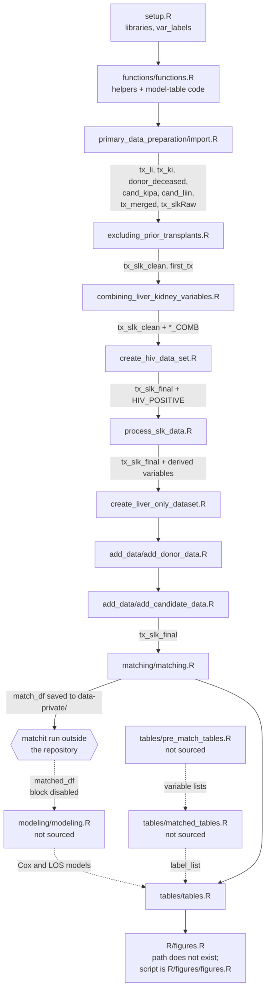
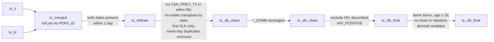

# HIV SLK Outcomes Architecture

> **Placeholder.** This describes `master` at commit `006159e` (2026-10-26), before the planned reorganization of the scripts. It will be regenerated once the reorganized code is merged; until then, `REPOSITORY-BLUEPRINT.md` shows the intended structure and `analysis-plan.md` the intended design. Nothing was executed and no SRTR data were available: this document comes from reading the code.

## Overview

The project compares outcomes after simultaneous liver–kidney (SLK) transplantation in recipients with and without HIV, using SRTR standard analysis files loaded through the separate [`sRtr`](https://github.com/VagishHemmige/sRtr) package. It works in five stages:

1. Load the liver and kidney transplant files and pair each person's liver and kidney records.
2. Keep first SLK transplants, apply exclusions, classify HIV status, and derive analysis variables.
3. Add donor and candidate variables.
4. Prepare data for propensity score matching (the matching itself runs outside the repository; see [Matching](#matching)).
5. Fit Cox and length-of-stay models in the matched cohort and produce tables and figures.

A Quarto website in `quarto/` is rendered to `docs/`. Its pages were adapted from another project and do not yet describe this project's scripts.

## Script and Object Flow

`R/main.R` sources scripts in order, and scripts share objects through the global environment. The diagram shows what `main.R` sources (solid) and what later steps need but `main.R` does not source (dashed).

### Current state of the pipeline

`main.R` does not run end to end at this commit:

- **`R/functions/functions.R`** defines helpers, then builds results tables from model objects (`cox_main`, `cox_kidney`, `cox_liver` and others) and fits interaction models from `matched_df`. Those objects do not exist when `main.R` sources the file second, so the run stops there.
- **`R/modeling/modeling.R`** and **`R/tables/tables.R`** do not parse: each contains R Markdown text and chunk fences. `main.R` does not source `modeling.R`.
- **`R/matching/matching.R`** saves the matching data and stops; the code that reads the matched result back and builds `matched_df` is inside `if (FALSE)`.
- **`R/tables/tables.R`** needs `matched_df`, the fitted models, and `label_list` from `matched_tables.R`, none of which `main.R` creates.
- **`main.R`** sources `R/figures.R`, which does not exist; the figures script is `R/figures/figures.R`.

## Components

### Setup

**Purpose**: Load libraries and define table labels.

**Location**: `R/setup.R`

**Key symbols**:
- Libraries for data management, `sRtr`, `strobe` and `flowchart`, `MatchIt`, `survival`, `MASS`, `sandwich`, `lmtest`, `gtsummary`, `gt`, `survminer`
- `conflict_prefer()` calls so `dplyr::select`, `filter` and `lag` win
- `var_labels` — named vector of readable labels for table variables

Analysis constants (study start year, age threshold, era cut-off, matching settings) are not defined here; they are hard-coded in the scripts that use them.

### Helper functions

**Location**: `R/functions/functions.R`

**Key functions**:
- `combine_li_ki_consistent()` — harmonizes a field recorded in both the liver and kidney files: positive if one is positive and the other positive or missing, negative likewise, missing when they conflict
- `recode_sex_FM()`, `recode_YNU()`, `recode_PNU()`, `recode_YNU_to_words()`, `collapse_donor_race()`, `make_missing_level()` — recoders
- `make_gtsummary_labels()` — converts `var_labels` for gtsummary
- `mk_tbl()`, `clean_labels()` — gtsummary regression tables
- `extract_hiv_row()`, `extract_interaction()`, `extract_robust()`, `format_cox()`, `fit_cox_capture_warning()` — model result extraction and formatting

The file also contains analysis code (results-table construction, a `gtsave()` to the project root, interaction models, and `library()` calls); see [Current state](#current-state-of-the-pipeline).

### Cohort construction

**Location**: `R/primary_data_preparation/`

| Script | What it does |
|---|---|
| `import.R` | Loads `tx_li`, `tx_ki`, `donor_deceased`, `txf_li`, `txf_ki`, `malig`, `immuno`, `cand_kipa`, `cand_liin` and `pra_hist` with `load_srtr_file()`; checks transplant dates are `Date` and `DONOR_ID` is present; full-joins liver and kidney records by `PERS_ID` (suffixes `_LI`, `_KI`); keeps pairs transplanted within one day of each other as `tx_slkRaw` |
| `excluding_prior_transplants.R` | Excludes prior transplants by the `CAN_PREV_TX` flags and by earlier transplant dates (`first_tx`); keeps each person's first SLK; removes same-day duplicate records by a rule applied to graft failure dates; writes the duplicate records to `data-private/` for manual review; stops unless one row per `PERS_ID` remains |
| `combining_liver_kidney_variables.R` | Creates harmonized hypertension, CMV, HCV, HBV core antibody, HBV surface antigen and malignancy variables with `combine_li_ki_consistent()` |
| `create_hiv_data_set.R` | Cleans `REC_HIV_STAT` in both files, excludes records positive in one file and negative in the other, and sets `HIV_POSITIVE` (positive in one file and positive or missing in the other); creates `tx_slk_final` |
| `process_slk_data.R` | Excludes different liver and kidney donors, recipients under 16, and kidney–liver–heart or –intestine transplants; derives donor BMI, graft failure and death times, composite transplant and death dates, recipient and donor characteristics, OPTN diagnosis groups, `YEAR_TRANSPLANT`, `ERA` (pre-DAA before 2014), MELD/PELD, causes of graft failure, payer, collapsed race and length of stay |
| `create_liver_only_dataset.R` | Starts a liver-only comparison cohort; writes records to `data-private/` for manual review; the rest is inside `if (FALSE)` |

**Output**: `tx_slk_final`, one row per SLK recipient with `_LI` and `_KI` copies of transplant-file fields plus derived variables. The 2005 study-start restriction is not applied here; it is applied in `matching.R`.

### Adding donor and candidate data

**Location**: `R/add_data/`

- `add_donor_data.R` — sets `DONOR_ID` from the liver record and left-joins `donor_deceased`; recodes donor HIV NAT, HIV antibody, HCV and hepatitis B core antibody. A liver-only block is inside `if (FALSE)`.
- `add_candidate_data.R` — left-joins `cand_kipa` on the kidney `PX_ID` and `cand_liin` on the liver `PX_ID`; recodes diabetes, dialysis, BMI, time on dialysis, functional status, and liver candidate yes/no/unknown fields.

Both joins drop duplicated columns with `select(-ends_with(".y"))` and strip `.x` suffixes. Neither checks the row count after joining.

`add_followup_data.R`, `add_immuno_data.R`, `add_malignancy_data.R` and `add_pra_data.R` join other SRTR files into separate objects. `main.R` does not source them.

### Matching

**Location**: `R/matching/matching.R`

- Restricts `tx_slk_final` to transplants in 2005 or later and selects the matching and outcome variables as `match_df`.
- Converts the transplant date to a number for the caliper and gives the serology covariates an explicit `"Missing"` level.
- Saves `match_df` to `data-private/`.
- A commented-out block records the `matchit()` call that was run in a separate session: logistic propensity score on recipient age, sex and race, last MELD, HCV, primary liver and kidney diagnosis, donor age and sex, HBV surface antigen and CMV; nearest neighbour, ratio 1:5, exact on `ERA`, 365-day caliper on transplant date.
- A disabled block reads the matched result from a file outside the project, joins `subclass`, `weights` and `distance` back to `tx_slk_final` as `matched_df`, recodes serologies and sets labels.

### Modeling

**Location**: `R/modeling/modeling.R` (not sourced; does not parse)

All Cox models use robust standard errors clustered on `subclass`.

- Overall mortality: unadjusted, HIV × era interaction, and within each era
- Death-censored kidney and liver graft failure: defines `LI_*` and `KI_*` time and event variables, then fits unadjusted, interaction and era-specific models
- Proportional hazards checks with `cox.zph()`
- Length of stay among those discharged alive: negative binomial (unadjusted and with era) and log-linear models with cluster-robust standard errors
- Era-specific mortality models adjusted for HBV surface antigen and CMV

Models with `+ ERA` (`cox_main_effects`, `cox_kidney_era`, `cox_liver_era`) are commented out, but `tables/tables.R` uses them.

### Tables

**Location**: `R/tables/`

| Script | Sourced by `main.R` | Output |
|---|---|---|
| `pre_match_tables.R` | No | Donor, recipient and candidate tables of `tx_slk_final` by HIV status; defines the variable lists used by `matched_tables.R` |
| `matched_tables.R` | No | Full matched-cohort table; defines `label_list` |
| `tables.R` | Yes (does not parse) | Condensed poster table; mortality, kidney and liver graft failure model tables; poster summary and interaction tables; length-of-stay table; adjusted-model text summary |

Most tables are saved to `tables/`. One is saved to the project root, and the adjusted-model summary is written to a folder outside the project.

### Figures

**Location**: `R/figures/figures.R` (`main.R` sources `R/figures.R` instead)

- Kaplan–Meier survival curves by HIV status, overall and within each era, with risk tables, saved to the project root
- Log-rank tests and median survival tables

## Data Flow

SRTR files → `tx_merged` (all liver–kidney record pairs per person) → `tx_slkRaw` (SLK pairs) → `tx_slk_clean` (first SLK, no prior transplants, one row per person) → `tx_slk_final` (HIV classified, exclusions applied, derived, donor and candidate variables added) → `match_df` (2005 onward, matching variables) → external `matchit()` run → `matched_df` (matched cohort with `subclass`) → models → tables and figures.

## Configuration

- **Data location**: `sRtr::set_srtr_wd()`, called by the person running the analysis before `main.R`.
- **Analysis settings** are hard-coded where used: one-day SLK window (`import.R`), age ≥ 16, DAA era cut-off at 2014 and multi-organ exclusions (`process_slk_data.R`), 2005 study start and matching specification (`matching.R`).
- **File outputs**: `data-private/` (review extracts and `match_df`), `tables/`, the project root, and a folder outside the project.

## Scripts Not Sourced by `main.R`

| Script | Purpose |
|---|---|
| `R/abstract.R` | Earlier matched analysis for a conference abstract |
| `R/combine_identical.R` | Finds liver and kidney columns with identical values |
| `R/data_validation.R` | Reviews records with different liver and kidney donors (does not parse) |
| `R/misc/primary_diagnosis.R` | Lists primary diagnosis codes for categorization |
| `R/add_data/add_followup_data.R`, `add_immuno_data.R`, `add_malignancy_data.R`, `add_pra_data.R` | Merges of other SRTR files |
| `R/tables/pre_match_tables.R`, `R/tables/matched_tables.R` | See [Tables](#tables) |
| `R/modeling/modeling.R` | See [Modeling](#modeling) |
| `rmd/SLK_1.8.rmd`, `rmd/SLK_2.8.rmd` | R Markdown notebooks the scripts were split from |

## Code References

| Component | File | Key symbols |
|---|---|---|
| Orchestration | `R/main.R` | — |
| Setup | `R/setup.R` | `var_labels` |
| Helpers | `R/functions/functions.R` | `combine_li_ki_consistent()`, `make_missing_level()`, `extract_hiv_row()`, `extract_interaction()`, `extract_robust()`, `format_cox()` |
| SLK definition | `R/primary_data_preparation/import.R` | `tx_merged`, `tx_slkRaw` |
| Exclusions | `R/primary_data_preparation/excluding_prior_transplants.R` | `first_tx`, `tx_slk_first`, `tx_slk_clean` |
| Harmonized serologies | `R/primary_data_preparation/combining_liver_kidney_variables.R` | `REC_HCV_STAT_COMB`, `REC_CMV_COMBINED`, `REC_HBV_SURF_ANTIGEN_COMB` |
| HIV status | `R/primary_data_preparation/create_hiv_data_set.R` | `HIV_DISCORDANT`, `HIV_POSITIVE`, `tx_slk_final` |
| Derived variables | `R/primary_data_preparation/process_slk_data.R` | `REC_DEATH_yrs`, `REC_DEATH_BINARY`, `ERA`, `MELD_NUM_Last`, `los_days_inclusive` |
| Donor and candidate data | `R/add_data/add_donor_data.R`, `R/add_data/add_candidate_data.R` | `DON_*_RECODED`, `CAN_*_recode` |
| Matching | `R/matching/matching.R` | `match_df`, `matched_df`, `subclass` |
| Models | `R/modeling/modeling.R` | `cox_main`, `cox_int`, `cox_kidney`, `cox_liver`, `KI_EVENT`, `LI_EVENT`, `nb_los` |
| Tables | `R/tables/*.R` | `tbl_mega`, `mega_df`, `label_list` |
| Figures | `R/figures/figures.R` | `km_all`, `km_pre`, `km_post` |

## Glossary

| Term | Definition |
|---|---|
| SLK | Simultaneous liver–kidney transplant: a liver and a kidney transplant in the same person within one day |
| DAA era | Pre-DAA: transplant before 2014; post-DAA: 2014 onward (direct-acting antivirals for hepatitis C) |
| `_LI`, `_KI` | Suffixes for fields from the liver and the kidney transplant record after the join |
| `PERS_ID` | SRTR person identifier; links liver and kidney records |
| `PX_ID` | Candidate registration identifier; links to candidate files |
| `TRR_ID` | Transplant recipient registration identifier; links to follow-up files |
| `DONOR_ID` | Donor identifier; links to the deceased donor file |
| `subclass` | Matched-set identifier from `MatchIt`, used to cluster standard errors |
