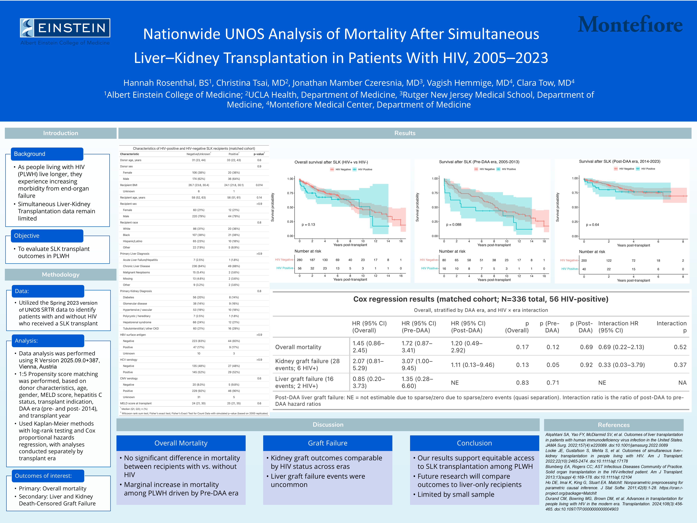

---
output:
  github_document:
    html_preview: false
---

<!-- README.md is generated from README.Rmd. Please edit that file -->

```{r, include = FALSE}
knitr::opts_chunk$set(
  collapse = TRUE,
  comment = "#>"
)
```

# HIV SLK outcomes

<!-- badges: start -->
[](#)
[](#)
[](#)
<!-- badges: end -->

The goal of `HIV SLK outcomes` is to compare the outcomes of people living with HIV (PLWH) who have undergone simultaneous liver-kidney transplant to controls without HIV using the [Scientific Registry of Transplant Recipients](https://srtr.transplant.hrsa.gov/) database.

This analysis is currently in progress.

The full analysis website, which explains the code step by step, is available at [https://vagishhemmige.github.io/HIV-SLK-outcomes/](https://vagishhemmige.github.io/HIV-SLK-outcomes/).

## Documentation

- [`analysis-plan.md`](analysis-plan.md): what the analysis is meant to do
- [`ARCHITECTURE.md`](ARCHITECTURE.md): how the code is organized
- [`AGENTS.md`](AGENTS.md): how to work in this repository
- [Issues](https://github.com/VagishHemmige/HIV-SLK-outcomes/issues): open decisions and known gaps

## Running the analysis

Run `R/main.R` from the project root. Requires authorized access to the SRTR standard analysis files under the SRTR data use agreement, located through the [sRtr](https://github.com/VagishHemmige/sRtr) package (`sRtr::set_srtr_wd()`).

## Presentations

These data have been presented at the NY-NJ Center for AIDS Research 2026 regional conference as a poster.



[Download the poster (PowerPoint)](poster/Poster.pptx)  
[Download as PDF](poster/Poster.pdf)
